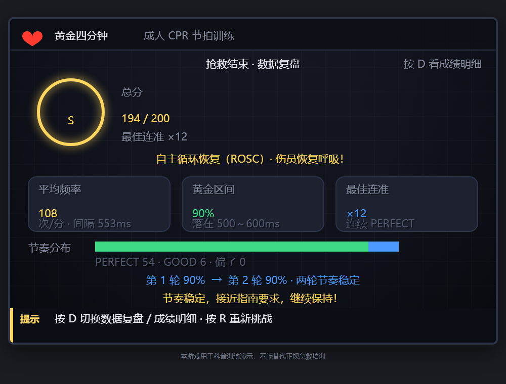

# 黄金四分钟 · CPR 节拍训练游戏（Golden 4 Minutes）

> 面向零基础学习者的心肺复苏节奏训练网页游戏 —— 把「看视频学会了」变成「亲手按对了」。

[在线试玩](https://zhuang-yq.github.io/CPR-Golden-Minutes/) · 双击 `index.html` 离线可玩

## 为什么做这个

### 1. 更根本的缺口：「公共场所配了 AED」≠「人人会救」

谈 CPR 普及，落点常在**场所与设备**：机场地铁配 AED、宣传栏贴步骤图、公众号发推文。但设备在墙上、知识在网上，不等于事发那一刻站在旁边的人敢上手——真正决定黄金四分钟里发生什么的，是恰好路过的那个普通人。所以 CPR 该覆盖的是**人**、是全民，而不只是公共场所。

系统学习集中在医护、急救员等特定职业，绝大多数普通人在学业与工作之外几乎没有「被要求学会 CPR」的机会；图文视频是抽象的「看」，判断 → 呼救 → 按压 → 吹气 → AED 这套**完整流程从未在脑子里串起来过**；正规培训又要报名、课时、模型人。结果真有人倒下，第一目击者卡住的往往不是「不会按」，而是「脑子一片空白、不敢上手、不知道第一步」。知识背得出来，流程却走不出来。

### 2. 医学侧的硬约束

心脏骤停后的黄金抢救时间只有 4～6 分钟，救护车平均到达时间远超于此；现场立即 CPR + 3～5 分钟内除颤，存活率可达 **49%～75%**，什么都不做则每过 1 分钟下降 **7%～10%**。而高质量 CPR 要求按压频率落在 **100～120 次/分**——看教学视频「看会了」≠ 节奏做对了，这是肌肉记忆，只有**亲手按、被测量**才能学会。

### 3. 本作品补哪一段

把五步完整流程做成 3 分钟一局、扫码即玩的场景化体验：跟着节拍器按压，逐次判定并给出「太快了／太慢了」的具体指导，结算再给出平均频率与黄金区间占比。让没有模型人、没上过课的普通人，先用一种**形象的方式**把整套流程走通一遍——把「零接触」变成「第一次接触」。

⚠️ 它不替代正规实操培训，补的是全民普及里最缺、也最难迈出的第一步。

## 玩法（3 分钟一局）

| 阶段 | 操作 | 训练点 |
|------|------|--------|
| ① 判断意识 | 连按 F 拍肩呼唤 | 反应速度（3 秒内满分） |
| ② 呼救 | 二选一：谁去打 120 | 施救者不能离开伤员 |
| ③ 胸外按压 | 跟节拍按空格 ×30 | **100～120 次/分节奏**（核心） |
| ④ 人工呼吸 | 按住 B 计时松手 | 每次吹气约 1 秒 |
| ⑤ AED | 按提示顺序四步操作 | 开机→贴片→离开→电击 |

电脑用键盘，手机用屏幕虚拟按键（按当前阶段自动切换）。评分满分 200（节奏 120 + 流程 30 + 吹气 20 + 反应 30），S/A/B/C 四级。

结算页默认展示**数据复盘**：平均频率、黄金区间占比、判定分布堆叠条、两轮趋势与个性化建议；按 D 切回成绩明细，按 R 重新挑战。



## 医学依据与边界

- 按压频率 100～120 次/分、深度 5～6 cm、按压:吹气 = 30:2，依据美国心脏协会（AHA）2025 成人基础生命支持指南
- ⚠️ **本游戏用于科普训练演示，不能替代正规急救培训**（此声明亦在游戏界面内展示）

## 技术要点

- 单文件游戏逻辑（`game.js`），**逻辑与渲染分离**：状态机 `CPRGame` 可脱离浏览器被 Node 无头驱动
- 固定步长 1/60 秒更新，渲染与逻辑解耦
- 验收测试 `test-cpr.js`：47 项断言覆盖节拍判定边界值、评分公式、状态机三种路径、30:2 循环计数、成绩复盘统计

```bash
node test-cpr.js   # 运行验收测试（需 Node.js）
```

- 节拍音由 WebAudio 振荡器实时生成，**零音频文件、零依赖**
- 高清渲染：画布按设备像素比放大绘制，文字锐利

## 开发方式：零基础 AI 协作

本项目由一名临床医学专业大一新生（零编程基础）通过 AI 协作完成：人负责提需求（PRD）、试玩找问题、做验收决策；AI 负责代码实现。全程有 PRD 驱动、可量化验收、git 提交记录可查。方法论详见提交历史与文档。

## 文件结构

```
index.html            入口
style.css             页面样式
game.js               游戏逻辑 + 渲染（逻辑层可被 test 无头调用）
PRD.md                产品需求文档（含可量化验收标准与变更记录）
test-cpr.js           验收测试（47 项断言）
README.md             本文件
screenshot-review.png 数据复盘页截图
```
